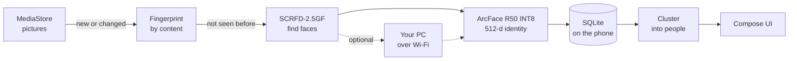

<div align="center">


# Glimpse

**Finds the people in your photos, on your phone.**

Every face in your gallery, grouped into people. Detection and recognition run on the phone itself:<br>
no uploads, no account, no servers.

[](https://github.com/sam404rihan/glimpse/actions/workflows/ci.yml)
[](LICENSE)


[**Download**](https://github.com/sam404rihan/glimpse/releases) · [Features](#features) · [Privacy](#privacy) · [Build](#build-from-source) · [How it works](#how-it-works)

</div>

---

## Features

<table>
<tr>
<td width="50%" valign="top">

### People
Everyone who shows up in 5 or more of your pictures, grouped automatically. Name them, merge two groups that are really one person, or take out a picture with **Not them**. Every fix can be undone.

</td>
<td width="50%" valign="top">

### Group search
Pick several people, or type `alex, sam & kim`, to see the pictures they're in. **Together** shows every picture they all appear in. **Only them** hides pictures where anyone else is clearly visible.

</td>
</tr>
<tr>
<td valign="top">

### Your whole gallery
Every picture by date, internal storage and SD card. Pinch to resize the grid, drag the edge handle to fly through years, swipe down to close a photo. Back always returns you to where you were.

</td>
<td valign="top">

### Delete face data, safely
Forget a person's faces and name for good, behind your fingerprint, face unlock or PIN. Glimpse never touches the pictures themselves.

</td>
</tr>
<tr>
<td valign="top">

### Analysed once
Results are tied to each picture's content, not its file. Moving, renaming or copying a picture, swapping the SD card, or restoring from the trash doesn't trigger another scan.

</td>
<td valign="top">

### Optional PC boost
Pair your own computer and let its GPU find faces over home Wi-Fi. If the PC goes away, the phone carries on alone.

</td>
</tr>
</table>

## Privacy

> [!NOTE]
> Glimpse **only reads** your pictures. It never copies, moves, edits, deletes or uploads them.

|  |  |
|---|---|
| **Where your data lives** | Face positions, identity vectors and names stay in Glimpse's private database on the phone. Thumbnails are only kept in memory. |
| **Network** | Off unless you pair a PC, and then only addresses on your home network (`10.x`, `172.16–31.x`, `192.168.x`) are accepted. |
| **Tracking** | None. No account, analytics, ads or crash reporting. |
| **Permissions** | Photos (read), notifications (scan progress), a foreground service for scanning, biometrics (to confirm deletions), and network (used only by the optional PC helper). |

## Install

1. Download the APK from [**Releases**](https://github.com/sam404rihan/glimpse/releases).
2. Open it on your phone and allow *Install unknown apps* when asked.
3. Open Glimpse and allow access to pictures. The first scan runs in the background with a notification.

> [!IMPORTANT]
> The face models come from [InsightFace](https://github.com/deepinsight/insightface) and are licensed for **non-commercial use only**. That applies to every APK that contains them, including the releases here.

## Build from source

**You need:** JDK 17, the Android SDK (API 36) and Python 3.10+.

```sh
# 1. Build the face models once: downloads InsightFace buffalo_m (~260 MB), converts it for the phone
pip install -r tools/requirements.txt
python tools/export_models.py            # → app/src/main/assets/models/{det,rec}.ort

# 2. Build the app
./gradlew assembleRelease                # → app/build/outputs/apk/release/app-release.apk
```

<details>
<summary><b>Signing and application ID</b> (optional, git-ignored)</summary>

<br>

**Release signing.** Without a `keystore.properties`, release builds are signed with your debug key, which is fine for your own phone. To sign real releases, add this file to the repository root:

```properties
storeFile=release.jks
storePassword=…
keyAlias=glimpse
keyPassword=…
```

**Application ID.** To build with an ID other than `io.github.sam404rihan.glimpse`, set it in `local.properties`:

```properties
glimpse.applicationId=com.example.glimpse
```

Android keeps an app's data across updates only when the ID and signature match, so this lets you keep updating an existing install.

</details>

## PC helper

A desktop GPU finds faces in a fraction of the time a phone needs. On the PC:

```sh
pip install -r tools/requirements.txt    # add torch + onnx2torch for an NVIDIA GPU
python tools/pc_helper.py                # Windows: double-click tools/pc_helper.bat
```

It prints a code like `192.168.1.5:8765/abcdefghjk`. In Glimpse, open **Pictures → ⋮ → Find faces on PC…** and type it in.

- Each photo travels over your Wi-Fi as a 1600 px JPEG and is analysed in memory, then dropped. Only face boxes and identity vectors go back to the phone.
- The pairing code lives in `~/.glimpse-pc-helper/`. Delete that folder to unpair every phone.

## How it works



| Stage | Details |
|---|---|
| **Scanning** | `MediaStoreSource` reads each storage volume incrementally (MediaStore generations). A content fingerprint ties results to the picture, so files can move freely. |
| **Detection** | SCRFD-2.5GF (fp32, 3.4 MB) on a 640 × 640 letterbox of the picture decoded to at most 1600 px. |
| **Recognition** | Faces are aligned to 112 × 112 and embedded by ArcFace R50 (INT8, 44 MB, about 7× faster than fp32 with identical grouping on the test set). |
| **Grouping** | `Clusterer` attaches faces to people by cosine similarity, with stricter rules for small or blurry faces. Your names, merges and "Not them" are never undone by regrouping. |
| **Runtime** | ONNX Runtime on the CPU's big cores in a foreground service. A periodic job picks up new pictures while the phone charges. |

<details>
<summary><b>Code map</b></summary>

```
app/src/main/java/app/glimpse/
├── index/     scanner rules: what to analyse, what to keep
├── android/   MediaStore, face engine, PC link
├── faces/     SCRFD decoding, alignment
├── people/    grouping into people
├── data/      SQLite store
├── scan/      foreground service, background worker
└── ui/        Jetpack Compose screens
tools/         model export, Python reference pipeline, PC helper
```

</details>

## Tests

| Command | Covers |
|---|---|
| `./gradlew testDebugUnitTest` | SCRFD decoding and alignment against the Python pipeline; grouping 120 LFW pictures of 10 people with the shipped recogniser (100% purity); scanner rules (no re-analysis after moves, copies, restores, SD card swaps, widened access or interrupted scans) |
| `./gradlew connectedDebugAndroidTest` | The scanner rules on real SQLite, undo of merges and "Not them", and the on-device engine against PC goldens |
| `python -m pytest tools -s` | The phone models against the originals; regenerates the test fixtures |

> [!WARNING]
> `connectedDebugAndroidTest` uninstalls the app from **every** connected device before it runs. Unplug any phone whose Glimpse data you want to keep.

## License

Glimpse is released under the [Apache License 2.0](LICENSE). Third-party notices are in [NOTICE](NOTICE).

The InsightFace models aren't part of this repository and are for non-commercial use only.
